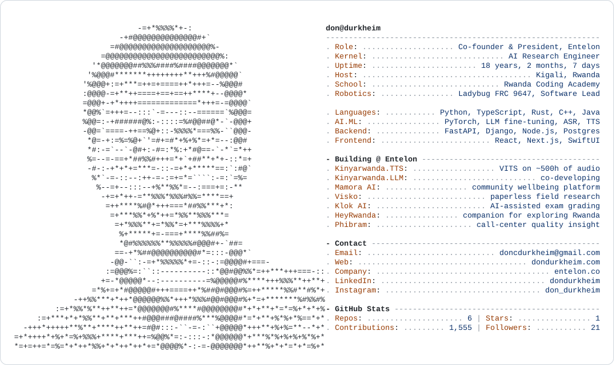

  <picture>
    <source media="(prefers-color-scheme: dark)" srcset="dark_mode.svg">
    
  </picture>

###

<h2 align="left">Hi 👋, I'm Don Durkheim.</h2>

###

<b>Co-founder & President of <a href="https://entelon.co">Entelon</a></b>, an AI and automation company based in Kigali, Rwanda.  
ai engineer. fully-stuck developer 💀.  
i spend 48 hours automating a 1-hour task.  
because the problem is more interesting than the solution.

###

<h2 align="left">what i do</h2>

###

i build ai pipelines that don't fall apart.  i write code that prints $ bills.  i mock people who think perfection matters.

###

<h2 align="left">what i'm building at entelon</h2>

###

🎙️ <b>Kinyarwanda speech</b>: a VITS text-to-speech model trained on ~500 hours of Kinyarwanda audio. 
🧠 <b>Kinyarwanda LLM</b>: co-developing a large language model for Kinyarwanda. 
🎧 <b>Phibram</b>: turns call-center and hotline conversations into a clear picture of service quality. 
🩺 <b>Mamora AI</b>: AI-powered community wellbeing platform for HDI Rwanda that helps detect disease outbreaks early. 
📋 <b>Visko</b>: takes the paperwork out of field research. Teams just talk through the questionnaires they already use. 
📝 <b>Klok AI</b>: reads handwritten exam answers and suggests marks step by step, with the teacher in charge of every grade. 
🧭 <b>HeyRwanda</b>: a companion for experiencing Rwanda, from choosing where to go to finding your way and paying.

###

<h2 align="left">a dream in motion</h2>

###

they call me <b>motion</b>. because i'm a dream in motion.  
🥁 brass drumming. 
📜 reading philosophy. 
🍽️ group dinners. people with diverse thoughts, same spirit. 
🎻 classical music moves me. 
⛪ the cathedral effect works on me.

###

<h2 align="left">in the toolbox</h2>

###

  
  
  
  
  
  
  
  
  
  
  
  
  
  
  
  
  
  
  
  
  
  
  
  
  
  
  
  
  
  
  
  
  
  
  
  
  
  
  
  
  
  
  
  
  
  
  
  
  
  
  
  
  
  
  

###

and many more… (not gon' list html, obviously 💀)

###

<h2 align="left">the reality</h2>

###

people like to lie.  it's a war of all against all.  but if you're building something real, i'm here.  i'll make sure it doesn't fall apart.  and i'll mock you the entire time.

###

<h2 align="left">find me</h2>

###

  
  
  
  
  

###

© 2026 Don Durkheim — Kigali, Rwanda — "Veni Vidi Vici" - Julius Caesar

###
